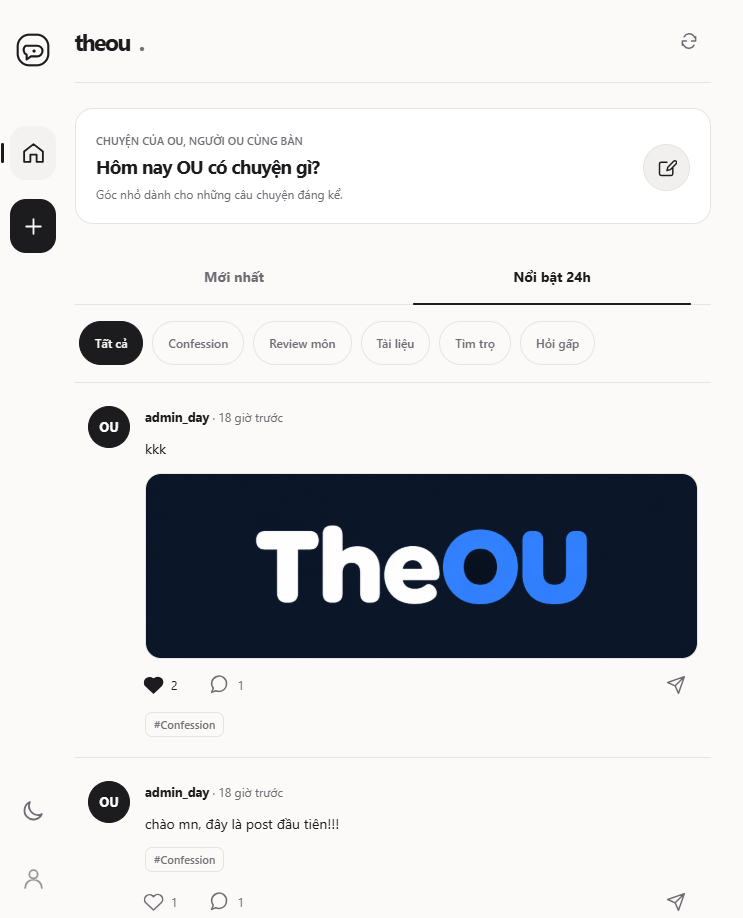
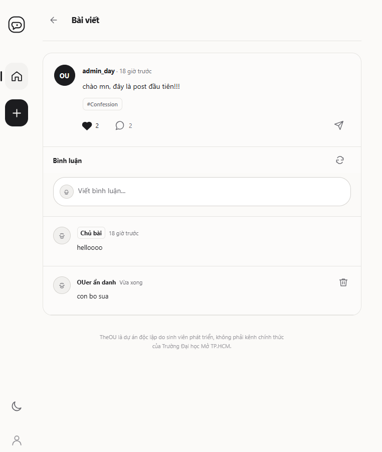
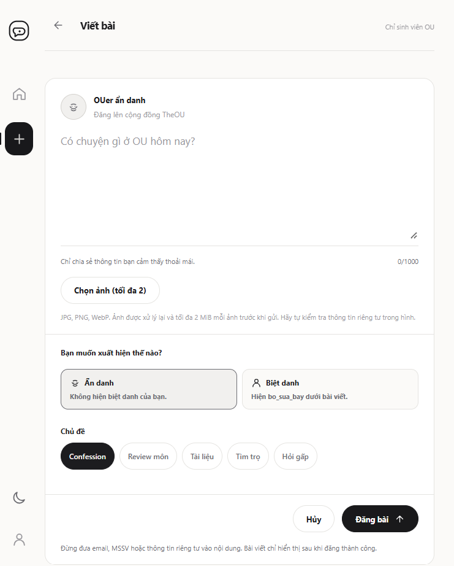
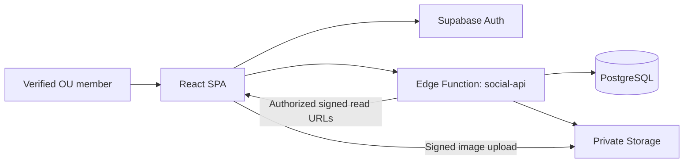

# TheOU

**An anonymous-by-default social platform for the Ho Chi Minh City Open University community.**

TheOU gives people with a verified `@ou.edu.vn` email a dedicated place to share campus stories, ask questions, and discuss student life. Members can publish anonymously or under a nickname, while the backend keeps account identity separate from public content.

**Backend-focused full-stack project** 
[Live Demo](https://theou.tech) | [Frontend Setup](frontend/README.md) | [Supabase Setup](supabase/README.md) | [Architecture](docs/04-ARCHITECTURE.md) | [Database Security](docs/05-DATABASE-SECURITY.md)


> **Independent project.** TheOU is not affiliated with or endorsed by Ho Chi Minh City Open University. Membership requires verification of an `@ou.edu.vn` mailbox; this does not independently confirm current enrollment.

## Product Preview

<!--
  ADD REAL SCREENSHOTS BEFORE PUBLISHING THIS README.
  Put your screenshots at the following paths, then commit them with README.md:
    docs/assets/screenshots/feed.png
    docs/assets/screenshots/post-detail.png
    docs/assets/screenshots/create-post.png
  Use sanitized demo content. Do not include real student data, email addresses,
  internal IDs, session tokens, or personally identifying photos.
-->

| Feed | Post Detail | Create Post |
|:---:|:---:|:---:|
|  |  |  |
| Browse recent and trending discussions | Read and join a conversation | Publish anonymously or with a nickname |

**Reviewing the project without an OU email?** The live community is restricted to verified `@ou.edu.vn` accounts, and there is no public guest account or read-only feed. The screenshots above provide a view of the main product flows; the architecture, source code, and tests are available in this repository.

## Features

- **Campus-only access:** email/password registration, one-time email verification via OTP, and server-side account checks.
- **Anonymous or nickname-based posting:** a shared feed with five campus-related topics, NEW/HOT (24-hour) sorting, and keyset pagination.
- **Social interactions:** comments, toggleable upvotes, and a *Chủ bài* (original poster) label that does not reveal the author's account identity.
- **Private image attachments:** up to two images per post, using authorized signed upload and read URLs.
- **Content controls:** owner-initiated soft deletion and admin-only hiding of posts/comments with an audit trail.

## Tech Stack

| Layer | Technologies |
|---|---|
| Frontend | React 19, TypeScript, Vite, Tailwind CSS |
| Client routing & server state | React Router, TanStack Query |
| Business API | Supabase Edge Functions, TypeScript, Deno |
| Authentication | Supabase Auth |
| Data | PostgreSQL, migrations, constraints, triggers, RLS |
| Media | Private Supabase Storage |
| Hosting & CI | Vercel, Supabase, GitHub Actions |

## System Architecture



The React client uses Supabase Auth for sessions. **All social business operations go through `social-api`**, rather than direct reads and writes to application tables. This keeps authentication, authorization, and public response shaping at a controlled server boundary. The frontend depends on a typed `SocialApiClient` contract, making the API implementation replaceable without rewriting the UI.

### Engineering Decisions

**1. Protect anonymous identity at the API boundary.** Anonymous posts must not expose an account identifier that can be correlated across discussions. The API returns allowlisted public DTOs (such as `authorLabel`, `isMine`, and `isOriginalPoster`) instead of raw rows. Direct client access to business tables is restricted through grants and RLS; server-side authorization checks also apply when privileged database credentials are used.

**2. Enforce consistency in PostgreSQL.** Post and comment creation use per-author idempotency keys so retries do not silently create duplicate content. Post publishing uses a conditional `DRAFT → PUBLISHED` transition. Unique vote constraints, explicit desired vote state, and database triggers keep concurrent interactions and engagement counters consistent without introducing a separate distributed-lock service.

**3. Authorize media throughout its lifecycle.** Images are stored in a private bucket. The backend reserves an upload slot, issues a signed upload token, validates the uploaded object, and marks it ready before the post can be published. Readers receive short-lived signed URLs only after the server verifies access.

**4. Make moderation accountable.** Owners can soft-delete their content. Admin-only moderation verifies permissions on the server and records the content change and audit entry together in a database transaction.

For implementation details and design boundaries, see the [architecture](docs/04-ARCHITECTURE.md), [security model](docs/05-DATABASE-SECURITY.md), and [API contract](docs/06-API-CONTRACT.md).

## Getting Started

### Requirements

- Node.js **22.18+** and npm (CI uses Node.js 24).
- Access to a configured Supabase project for authentication and live social features.

### Run the frontend

```bash
git clone https://github.com/NgnTienDat/TheOU.git
cd TheOU/frontend
npm ci
cp .env.example .env.local
```

Add your Supabase project values to `frontend/.env.local`:

```dotenv
VITE_SUPABASE_URL=https://YOUR_PROJECT_REF.supabase.co
VITE_SUPABASE_PUBLISHABLE_KEY=sb_publishable_...
```

Then start the development server:

```bash
npm run dev
```

Only the publishable key belongs in a `VITE_*` variable. Keep service-role keys, database credentials, SMTP credentials, and signing secrets out of the frontend and repository.

### Backend development and tests

The current development workflow uses **Supabase Cloud** for Auth, database, Storage, and the deployed `social-api` function. A Supabase local Docker stack is **not configured as a supported one-command setup** in this repository. To work on backend code and run its offline checks:

```bash
cd ../supabase
npm ci
npm run typecheck
npm test
```

These checks exercise the backend/SQL test setup without standing up the full live Supabase services. Running the application end to end requires a Supabase project configured with the repository migrations, Auth settings, the `social-api` Edge Function, a private `post-media` bucket, and an email provider. Follow the [Supabase setup guide](supabase/README.md) for the project-specific Cloud configuration and deployment procedure. Do not run database reset or migration push commands against a shared Cloud project without reviewing their effects.

## Testing

The project uses automated frontend and Supabase-side checks, alongside focused integration testing for authentication, authorization, and critical data flows.

| Area | Coverage |
|---|---|
| Frontend CI | Lint, TypeScript checks, unit tests, production build |
| Supabase-side CI | Edge checks and PGlite-backed database/API tests |
| Security | Invalid sessions, cross-account access, restricted raw-table access, role and ownership checks |
| Data integrity | Idempotent post/comment creation, concurrent votes, database-managed counts |
| Media and moderation | Private upload/read flows, deletion permissions, audit records |

**Latest documented local test snapshot:** **312 Supabase-side tests** and **94 frontend tests** passing. These numbers describe the recorded local suites, not a load benchmark or a claim that every browser test runs against live Cloud services.

## Future Improvements

- Expand member reporting and moderation workflows.
- Strengthen abuse prevention and operational monitoring before broader rollout.
- Automate media cleanup/recovery and establish repeatable staging and rollback procedures.
- Benchmark feed and interaction workloads before introducing caching or additional coordination components.

## Documentation

| Document | Purpose |
|---|---|
| [Product Requirements](docs/01-PRD.md) | Product goals and scope |
| [User Stories](docs/02-USER-STORIES.md) | User flows and acceptance criteria |
| [UI/UX Specification](docs/03-UI-UX-SPEC.md) | Screens and interaction behavior |
| [Architecture](docs/04-ARCHITECTURE.md) | Components and trade-offs |
| [Database & Security](docs/05-DATABASE-SECURITY.md) | Schema, authorization, anonymity model |
| [API Contract](docs/06-API-CONTRACT.md) | Client/server interface |
| [Implementation Plan](docs/07-IMPLEMENTATION-PLAN.md) | Engineering milestones and test gates |
