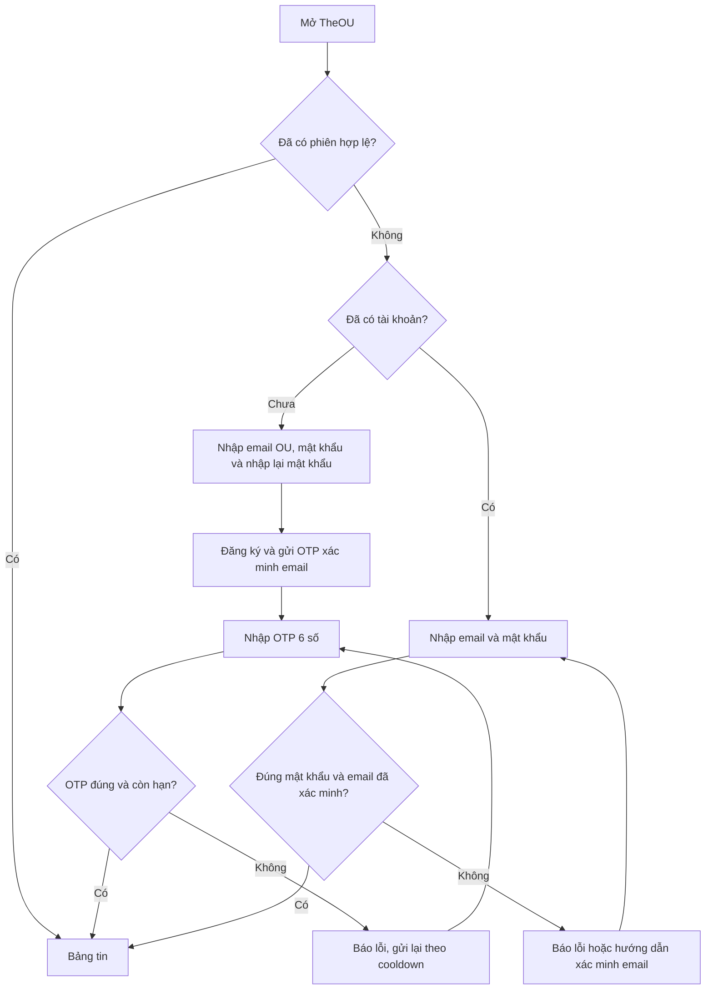
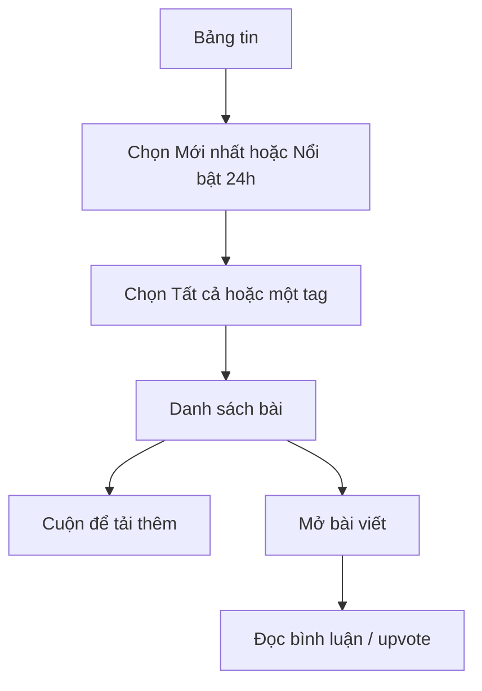
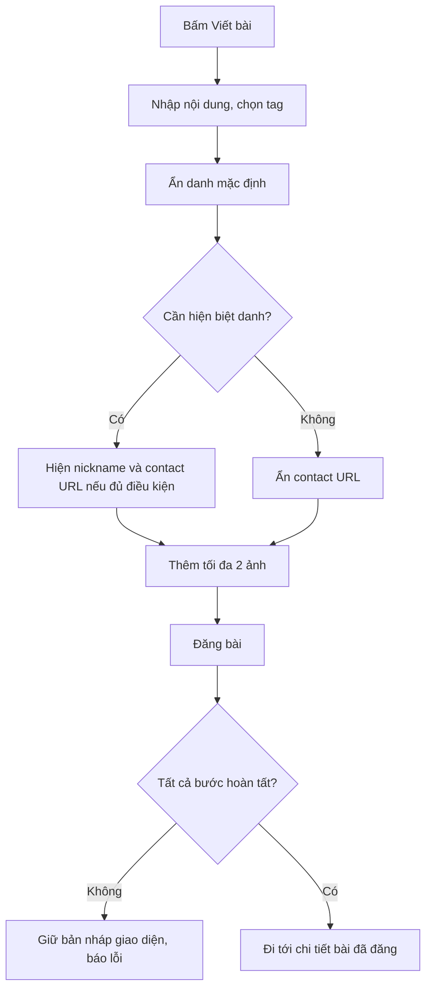

# 03 — Đặc tả UI/UX và User Flows

## 1. Định hướng giao diện

**UI baseline T05 đã duyệt:** [prototype và design conventions](fe-templates/README.md). React chuyển trực tiếp appearance/components của HTML; kiểm tra dark/light ở 360/390/768/1280px. Bỏ preview/mock/OTP mẫu. T05-A vào `/ca-nhan` sau xác thực/getMe, `/` tạm điều hướng về đó; feed là task sau.

- **Ưu tiên tiếng Việt**, đơn giản, ngắn gọn, không dùng thuật ngữ kỹ thuật với sinh viên.
- Mobile-first: một cột nội dung, tối đa rộng ~680 px cho feed trên desktop.
- Phong cách trung tính, dễ đọc, tập trung vào văn bản; không sao chép giao diện thương hiệu của nền tảng khác.
- Tránh dùng logo OU chính thức hoặc khiến người dùng hiểu nhầm sản phẩm thuộc trường.
- Accessibility cơ bản: nhãn input, focus visible, tương phản, thông báo lỗi có văn bản, nút tối thiểu 44×44 px trên mobile.

## 2. Danh sách màn hình

| Đường dẫn | Tên hiển thị | Ai vào được | Mốc |
|---|---|---|---|
| `/dang-nhap` | Đăng nhập | Khách | W1 |
| `/dang-ky` | Đăng ký | Khách | W1 |
| `/xac-thuc` | Xác minh email đăng ký | Khách có đăng ký đang chờ xác minh | W1 |
| `/` | Bảng tin | Thành viên OU | W1 |
| `/bai-viet/moi` | Viết bài | Thành viên OU | W1 |
| `/bai-viet/:id` | Chi tiết bài & bình luận | Thành viên OU | W2 |
| `/ca-nhan` | Biệt danh và đăng xuất | Thành viên OU | W1 |
| `/admin` | Kiểm duyệt tối thiểu | Admin | W2 |
| `/admin/bao-cao` | Danh sách báo cáo | Admin | W3 |
| `/quy-dinh` | Quy định cộng đồng | Tất cả | W4 |
| `/quyen-rieng-tu` | Quyền riêng tư | Tất cả | W4 |

Không làm chat, tìm kiếm, thông báo, trang người dùng công khai, profile người khác.

## 3. Luồng 1 — Xác thực



**Đăng ký:** email OU (`autocomplete="email"`), mật khẩu/nhập lại (`type="password"`, `autocomplete="new-password"`), nút `Đăng ký`. Không trim mật khẩu; tối thiểu 8 ký tự, tối đa 72 byte UTF-8. Sau đăng ký chưa có session; chuyển tới xác minh email, không vào feed.

**Xác minh đăng ký:** input 6 số (`inputmode="numeric"`, `autocomplete="one-time-code"`), nút `Xác minh email`, `Gửi lại mã` theo cooldown. Chỉ gửi lại mã xác minh signup, không gọi đăng nhập OTP. Không lưu mật khẩu vào URL, route state hoặc localStorage; xóa khỏi form khi rời bước đăng ký. Email được che bớt trên màn hình OTP.

**Đăng nhập:** email + mật khẩu (`type="password"`, `autocomplete="current-password"`), nút `Đăng nhập` và đường dẫn `Chưa có tài khoản? Đăng ký`. Không có bước gửi/nhập OTP khi đăng nhập. Chưa có nút/luồng quên hoặc đổi mật khẩu trong T03.

**Lỗi tiếng Việt:** `Email hoặc mật khẩu không đúng`, `Email chưa được xác minh`, `Mã xác minh sai hoặc đã hết hạn`, `Bạn có thể yêu cầu mã mới sau ... giây`, `TheOU chỉ cho phép đăng ký bằng email @ou.edu.vn.`. Không tiết lộ tài khoản có tồn tại qua lỗi đăng nhập/đăng ký trùng. Xử lý mất mạng, rate limit, chưa nhận thư, user bị khóa; nút có loading và chống submit trùng.

T05-A chuyển baseline thành React UI local; review và kiểm thử Cloud ở T05-B. T03/T04 đã nghiệm thu riêng.

## 4. Luồng 2 — Đọc bài và lọc



### Bố cục feed trên mobile

```text
┌────────────────────────────────────┐
│ TheOU                      [Cá nhân]│
│ Cộng đồng độc lập của OU            │
├────────────────────────────────────┤
│ [Mới nhất] [Nổi bật 24h]           │
│ [Tất cả] [Confession] [Review môn]  │
│ [Tài liệu] [Tìm trọ] [Hỏi gấp]      │
├────────────────────────────────────┤
│ OUer ẩn danh · #Confession · 2h     │
│ Có ai ...                           │
│ [Ảnh nếu có]                        │
│ [▲ 18]    [💬 6]                    │
├────────────────────────────────────┤
│ Bài kế tiếp ...                     │
└────────────────────────────────────┘
                 [+ Viết bài]
```

- Feed không kéo dữ liệu nếu chưa đăng nhập.
- Nút viết bài luôn dễ thấy trên mobile, không che nội dung quan trọng.
- Khi chuyển tab/tag, về đầu feed và reset cursor; giữ vị trí cuộn nếu mở bài rồi quay lại là cải tiến P1.
- Bài viết `ANONYMOUS` ghi `OUer ẩn danh`; `NICKNAME` ghi nickname snapshot.

## 5. Luồng 3 — Viết bài



**Trường hiển thị:** textarea giới hạn `1.000`, chọn 1 tag, công tắc `Đăng ẩn danh` **bật mặc định**, preview tác giả, tối đa 2 ảnh, nút `Đăng bài`.

**Lưu ý:** Liên kết liên hệ chỉ xuất hiện khi tag là `Tài liệu`/`Tìm trọ` và tắt ẩn danh. Khi chuyển sang ẩn danh, UI **xóa trường contact URL trong payload** để tránh lộ qua API. Backend vẫn validate độc lập.

Đăng nhiều ảnh: hiển thị tiến độ chuẩn bị, upload, xác nhận; chỉ thông báo thành công sau khi bài được publish. Nếu lỗi, có thể thử lại và không tạo bài đăng trùng.

## 6. Luồng 4 — Bình luận và upvote

- Chi tiết bài hiển thị nội dung và danh sách bình luận theo thời gian tăng dần.
- Form bình luận tối đa 500 ký tự, trạng thái gửi, lỗi gửi, nút thử lại.
- Tác giả bài viết (OP) khi bình luận: `Chủ bài`, không kèm nickname nếu bài ẩn danh.
- Người bình luận khác: `OUer ẩn danh`; có nút xóa cho bình luận của chính người dùng.
- Upvote phản hồi nhanh có xử lý rollback khi API trả lỗi.
- Không có lồng phản hồi nhiều cấp trong MVP. Trả lời một người là một bình luận mới trong cùng bài.

## 7. Luồng 5 — Kiểm duyệt

- Prototype: `/admin` có danh sách bài/bình luận cần gỡ thủ công (có thể tìm bằng ID/link), nút `Ẩn` + yêu cầu lý do; mục tiêu là xử lý được vi phạm ngay cả trước khi có UI report.
- MVP: `/admin/bao-cao` hiển thị danh sách report, lý do, link nội dung, trạng thái và thao tác xử lý.
- Người thường truy cập `/admin` nhận 403 + điều hướng về feed; **server cũng từ chối**.

## 8. Trạng thái giao diện bắt buộc

| Vị trí | Loading | Empty | Error |
|---|---|---|---|
| Feed | Skeleton 3 bài | `Chưa có bài viết nào. Hãy mở đầu câu chuyện!` | `Không tải được bảng tin` + Thử lại |
| Bình luận | Skeleton ngắn | `Chưa có bình luận nào` | `Không tải được bình luận` |
| OTP | Disable gửi trong lúc xử lý | — | Lỗi rõ nguyên nhân ở mức an toàn |
| Đăng ký/đăng nhập | Disable submit trong lúc xử lý | — | Lỗi trường nhập hoặc thông báo Auth an toàn |
| Viết bài | Loading trên nút Đăng | — | Giữ nội dung đang soạn |
| Ảnh | Placeholder | Không ảnh | Ảnh lỗi + tùy chọn thử lại |
| Admin | Skeleton danh sách | Chưa có báo cáo | Không thể tải thông tin |

## 9. Nội dung và giới hạn ngôn ngữ

- UI hiển thị **100% tiếng Việt** ở phần tự xây; không dùng `Sign in`, `Report`, `Feed` như nhãn chính.
- Không ép người dùng nhập họ tên thật hay MSSV.
- Lỗi kỹ thuật như mã SQL, stack trace, nội dung JWT phải được chuẩn hóa trước khi hiển thị.
- Footer: `TheOU là dự án độc lập, không phải kênh chính thức của Trường Đại học Mở TP.HCM.`
- Ẩn danh với **cộng đồng**, không phải miễn trách nhiệm với ban quản trị hệ thống.

## 10. Kiểm thử nhanh trên thiết bị

- Rộng 360/390/768/1280 px; Chrome Android và Safari iOS nếu có máy.
- Bàn phím mở không che nút OTP/Đăng; tag cuộn ngang không phá layout.
- Mạng chậm: skeleton, lỗi và thử lại; không nhân đôi bài nếu request timeout.
- Thời gian ngắn/khác múi giờ: hiển thị thời gian người dùng theo `Asia/Ho_Chi_Minh`; dữ liệu DB lưu UTC.
