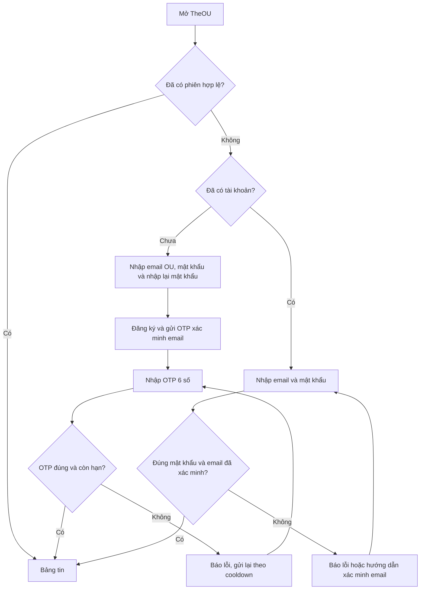
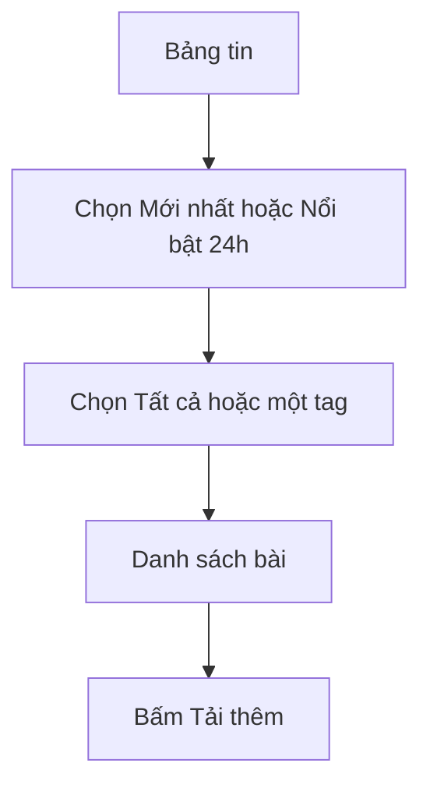
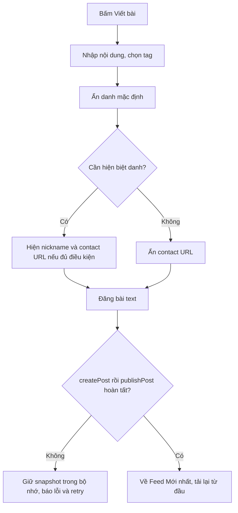

# 03 — Đặc tả UI/UX và User Flows

**Routing hiện hành — 24/11/2026:** `/` là Landing theo `TheOU-Landing-Black-White.html`, luôn hiển thị cho guest/member; `/bang-tin` là Feed. Login/OTP, logout, publish/delete và các nút quay lại Feed dùng `/bang-tin`. Landing demo không gọi API; guest Feed vẫn dùng allowlist server, không mở thêm dữ liệu công khai. Chỉ kiểm local, chưa deploy. Xem [báo cáo Landing](reports/LANDING-REACT-INTEGRATION.md).

## Guest feed — Phase A local, 23/11/2026

`/` hiển thị Landing; `/bang-tin` dùng FeedPage/shell V2 cho cả guest/member. Guest có NEW/HOT, tag, pagination, loading/empty/error/retry; Landing độc lập theo HTML Black-White đã duyệt. Read-only cards không link Detail hoặc ảnh, không vote/share/delete/contact. Hiện CTA **Đăng nhập để tương tác** → `/dang-nhap`; nút viết bài cũng tới login, nav Cá nhân/Admin bị ẩn. Empty state: chưa có bài công khai, không giả dữ liệu demo. Route Detail/Compose/Profile/Admin vẫn protected. Login về `/bang-tin`; logout điều hướng `/bang-tin` trước khi dọn session để tránh route trung gian/loop. Phiên loading/BANNED/error không kích hoạt member hoặc guest query; hiển thị trạng thái Auth/retry/logout. Giữ theme, responsive, focus và UI conventions đã duyệt; Cloud chưa kiểm thử.

## 1. Định hướng giao diện

Nhận diện hiện hành theo owner: logo chữ “t” trong ô nghiêng + “TheOU” thay “theou.” trên Landing và shell Feed. Desktop Feed chỉ chữ “TheOU” ở tiêu đề, chỉ một mark trên sidebar với shadow nhẹ; mobile header có cả mark/wordmark. Không đổi routing hoặc quyền guest/member.

**Visual reference hiện tại:** Auth dùng prototype T05; các trang social dùng [TheOU Social UI V2 và conventions](fe-templates/README.md). **UI-V2 — Post-T08 / Pre-T09: COMPLETED — PASS (17/11/2026)**; chủ dự án nghiệm thu visual6/6 và Cloud read-only regression6/6. Xem [báo cáo cuối](reports/UI-V2-STATUS-REPORT.md). T01–T08 giữ trạng thái nghiệm thu đã chốt. HTML quyết định appearance; bảo mật, API và nghiệp vụ vẫn theo tài liệu nguồn. Bỏ preview/mock/OTP mẫu. Login/OTP về `/bang-tin` sau getMe; `/ca-nhan` tiếp tục dành cho nickname/logout. T09-A upvote đã triển khai local, chờ review/deploy; chưa nghiệm thu T09.

- **Ưu tiên tiếng Việt**, đơn giản, ngắn gọn, không dùng thuật ngữ kỹ thuật với sinh viên.
- Mobile-first: social một cột tối đa640px, rail92px desktop (66px ở721–1100px), mobile≤720px có header/bottom nav. Auth giữ chiều rộng T05.
- Phong cách trung tính, dễ đọc, tập trung vào văn bản; không sao chép giao diện thương hiệu của nền tảng khác.
- Tránh dùng logo OU chính thức hoặc khiến người dùng hiểu nhầm sản phẩm thuộc trường.
- Accessibility cơ bản: nhãn input, focus visible, tương phản, thông báo lỗi có văn bản, nút tối thiểu 44×44 px trên mobile.

## 2. Danh sách màn hình

| Đường dẫn | Tên hiển thị | Ai vào được | Mốc |
|---|---|---|---|
| `/dang-nhap` | Đăng nhập | Khách | W1 |
| `/dang-ky` | Đăng ký | Khách | W1 |
| `/xac-thuc` | Xác minh email đăng ký | Khách có đăng ký đang chờ xác minh | W1 |
| `/` | Landing | Tất cả | Local verified |
| `/bang-tin` | Feed guest allowlist/member | Tất cả | Scope không đổi |
| `/bai-viet/moi` | Viết bài | Thành viên OU | W1 |
| `/bai-viet/:id` | Chi tiết bài & bình luận | Thành viên OU | W2 |
| `/ca-nhan` | Biệt danh và đăng xuất | Thành viên OU | W1 |
| `/admin` | Kiểm duyệt tối thiểu | Admin | W2 |
| `/admin/bao-cao` | Danh sách báo cáo | Admin | W3 |
| `/quy-dinh` | Quy định cộng đồng | Tất cả | W4 |
| `/quyen-rieng-tu` | Quyền riêng tư | Tất cả | W4 |

Không làm chat, tìm kiếm, thông báo, trang người dùng công khai, profile người khác.

## 3. Luồng 1 — Xác thực



**Đăng ký:** email OU (`autocomplete="email"`), mật khẩu/nhập lại (`type="password"`, `autocomplete="new-password"`), nút `Đăng ký`. Không trim mật khẩu; tối thiểu 8 ký tự, tối đa 72 byte UTF-8. Sau đăng ký chưa có session; chuyển tới xác minh email, không vào feed.

**Xác minh đăng ký:** input 6 số (`inputmode="numeric"`, `autocomplete="one-time-code"`), nút `Xác minh email`, `Gửi lại mã` theo cooldown. Chỉ gửi lại mã xác minh signup, không gọi đăng nhập OTP. Không lưu mật khẩu vào URL, route state hoặc localStorage; xóa khỏi form khi rời bước đăng ký. Email được che bớt trên màn hình OTP.

**Đăng nhập:** email + mật khẩu (`type="password"`, `autocomplete="current-password"`), nút `Đăng nhập` và đường dẫn `Chưa có tài khoản? Đăng ký`. Không có bước gửi/nhập OTP khi đăng nhập. Chưa có nút/luồng quên hoặc đổi mật khẩu trong T03.

**Lỗi tiếng Việt:** `Email hoặc mật khẩu không đúng`, `Email chưa được xác minh`, `Mã xác minh sai hoặc đã hết hạn`, `Bạn có thể yêu cầu mã mới sau ... giây`, `TheOU chỉ cho phép đăng ký bằng email @ou.edu.vn.`. Không tiết lộ tài khoản có tồn tại qua lỗi đăng nhập/đăng ký trùng. Xử lý mất mạng, rate limit, chưa nhận thư, user bị khóa; nút có loading và chống submit trùng.

T05-A chuyển baseline thành React UI local; review và kiểm thử Cloud ở T05-B. T03/T04 đã nghiệm thu riêng.

## 4. Luồng 2 — Đọc bài và lọc



### Bố cục feed trên mobile

```text
┌────────────────────────────────────┐
│ TheOU                      [Cá nhân]│
│ Cộng đồng độc lập của OU            │
├────────────────────────────────────┤
│ [Mới nhất] [Nổi bật 24h]           │
│ [Tất cả] [Confession] [Review môn]  │
│ [Tài liệu] [Tìm trọ] [Hỏi gấp]      │
├────────────────────────────────────┤
│ OUer ẩn danh · #Confession · 2h     │
│ Có ai ...                           │
│ [Ảnh nếu có]                        │
│ [▲ 18]    [💬 6]                    │
├────────────────────────────────────┤
│ Bài kế tiếp ...                     │
└────────────────────────────────────┘
                 [+ Viết bài]
```

- Guest Feed chỉ gọi `public-feed`; không tải member feed khi chưa đăng nhập hoặc khi session chưa được xác định.
- Nút viết bài luôn dễ thấy trên mobile, không che nội dung quan trọng.
- Khi chuyển tab/tag, về đầu feed và reset cursor; giữ vị trí cuộn nếu mở bài rồi quay lại là cải tiến P1.
- Bài viết `ANONYMOUS` ghi `OUer ẩn danh`; `NICKNAME` ghi nickname snapshot.

**Feed text:** chỉ render PostPublic, giữ xuống dòng; authorLabel lấy từ API, không ghép profile/email. Số comment chỉ đọc; T09-A biến icon vote thành button thật (local, chưa deploy). T08-A.1 dùng semantic stretched link phủ toàn PostCard tới `/bai-viet/:id`, có hover/focus và Enter, giữ Ctrl/Cmd/middle-click native. Text có thể chọn/copy, không điều hướng khi kéo chọn; contact link và button nằm trên lớp phủ, không lồng interactive elements. Không link tác giả; PostCard trong Detail không link về chính nó. Chưa có menu sửa/xóa bài hay media. Skeleton3, empty/error/retry, tải thêm có loading/error; cursor lỗi yêu cầu làm mới. Tag cuộn ngang; refresh và đổi sort/tag bắt đầu từ cursor null. HOT giữ thứ tự server; dedupe không bảo đảm không bỏ sót khi vote thay đổi. Upvote serialize theo post/phiên và đồng bộ cache theo quy tắc bên dưới.

## 5. Luồng 3 — Viết bài



**Trường T07:** textarea đếm `body.trim()` theo Unicode code points, 1–1.000 ký tự; chọn 1 tag (Confession mặc định), chọn `Ẩn danh` **mặc định** hoặc `Biệt danh`, preview tác giả, nút `Đăng bài`. Từ chối NUL/lone surrogate. Ảnh thuộc T10, hiện không có input upload.

**Lưu ý:** Liên kết liên hệ chỉ xuất hiện khi tag là `Tài liệu`/`Tìm trọ` và tắt ẩn danh. Khi chuyển sang ẩn danh, UI **xóa trường contact URL trong payload** để tránh lộ qua API. Backend vẫn validate độc lập.

Contact dùng HTTPS và exact hostname theo allowlist T06; không credentials/cổng khác mặc định/khoảng trắng/control. Đổi sang ẩn danh hoặc tag khác sẽ xóa giá trị contact và bỏ hẳn field khỏi payload.

T07 chỉ thông báo thành công sau publish, về Feed `/bang-tin` thay vì trang chi tiết W2. UUID/payload canonical được khóa sau lần gửi đầu; retry create dùng cùng key/payload, đã ACK thì retry publish cùng postId. Fields bị khóa khi đang gửi hoặc chờ retry, text không mất khi lỗi mạng/server. Không lưu nội dung/key/postId vào storage. Rời qua link nội bộ có confirm; reload/đóng tab có cảnh báo native, Back/Forward SPA chưa chặn. Reload/rời trang hoặc Auth revalidation làm unmount có thể mất draft/trạng thái chưa rõ; không tự tạo bài mới để phục hồi. Quy trình có ảnh và khôi phục draft qua server thuộc các task sau.

## 6. Luồng 4 — Bình luận và upvote

- Chi tiết bài hiển thị nội dung và danh sách bình luận theo thời gian tăng dần.
- Form bình luận tối đa 500 ký tự, trạng thái gửi, lỗi gửi, nút thử lại.
- Tác giả bài viết (OP) khi bình luận: `Chủ bài`, không kèm nickname nếu bài ẩn danh.
- Người bình luận khác: `OUer ẩn danh`; có nút xóa cho bình luận của chính người dùng.
- T08-A.1 giữ route protected `/bai-viet/:id`, dùng một container hội thoại liên tục: header Back icon + `Bài viết` → post → separator → inline composer → separator → comments/load more. Không chia thành các card nổi hoặc heading lớn cho form. Chỉ PUBLISHED; NOT_FOUND/parent vừa bị ẩn thì bỏ tương tác và không hiển thị comments cũ.
- Comment list chỉ VISIBLE, ASC createdAt/id, page20, opaque cursor; tải thêm/dedupe/refresh. Query key tách postId và session scope. Loading/empty/error/retry; V2 chỉ dùng biểu tượng ẩn danh giống nhau, không avatar thật, profile link hoặc khóa nhận diện commenter.
- Form trim1–500 Unicode code points, chặn NUL/lone surrogate, counter/focus/error. Tạo snapshot/key trước gửi; timeout retry cùng snapshot/key, giữ text và khóa field khi chưa rõ kết quả. Không persist nội dung/key; rời/reload hoặc Auth unmount chưa khôi phục draft comment.
- Composer desktop là ô bo tròn với placeholder `Viết bình luận...`, rỗng chỉ có textarea. Khi có text, hiện nút arrow-up; chỉ enabled nếu hợp lệ, hoặc retry snapshot đã khóa. Textarea tự tăng tối đa160px/30% viewport rồi cuộn; Enter xuống dòng, Ctrl/Cmd+Enter gửi (không gửi khi IME composing). Loading khóa gửi trùng, lỗi giữ nội dung/key.
- Mobile V2≤720px: composer fixed full-width phía trên bottom nav64px cộng safe-area, có background/border. ResizeObserver đo chiều cao thực để chừa đáy thread; khi VisualViewport thu nhỏ do bàn phím, tạm ẩn nav và đặt form trong viewport khả dụng. Một form giữ nguyên draft/retry state khi đổi breakpoint; không autofocus vào Detail. Kiểm tra360/390px; mô phỏng browser không thay thế bàn phím iOS/Android thật.
- Icon stroke20px thống nhất cho Back/refresh/send/delete, chevron-down kèm text cho tải thêm; không thêm dependency. Icon button44×44px, aria-label tiếng Việt, title khi cần, focus ring và disabled/loading. Không thêm profile link/avatar cho commenter hay action giả; upvote thật thuộc T09-A.
- Xóa chỉ trên comment của mình, có confirm, disabled/loading và lỗi an toàn. Timeout chưa được coi là xóa thành công; success thì reset list từ cursor null và refetch detail/feed counts từ server, không tự cộng/trừ count.
- **T09-A local:** heart outline/active, semantic button aria-pressed/label Upvote hoặc Bỏ upvote, focus-visible và vùng chạm ít nhất44px kể cả spinner pending. Click không mở Detail; giữ text selection/contact. Pending khóa cùng post/phiên ở mọi view, count optimistic ±1 không âm. Lỗi rollback snapshot an toàn, hiển thị tiếng Việt và nút retry cùng desiredState nếu chưa rõ ACK; refetch sau settle. Feed/Detail chia sẻ QueryClient theo scope, logout xóa cache; NEW giữ thứ tự, HOT reset cursor null theo server. Không downvote, comment reaction hoặc last-request-wins. Chưa deploy/nghiệm thu Cloud T09.
- Không có lồng phản hồi nhiều cấp trong MVP. Trả lời một người là một bình luận mới trong cùng bài.

## 7. Luồng 5 — Kiểm duyệt

- T11-A local: `/admin` là form tối giản, chỉ hiện khi getMe.isAdmin=true; POST nhận UUID hoặc URL cùng origin `/bai-viet/:id` (không query/hash/credentials), COMMENT nhận exact UUID. Lý do trim1–500 Unicode code points, không control/format/surrogate; xác nhận native trước khi gửi. Có pending/disable/success/lỗi tiếng Việt, không preview target, report queue hoặc dữ liệu tác giả.
- MVP: `/admin/bao-cao` hiển thị danh sách report, lý do, link nội dung, trạng thái và thao tác xử lý.
- Người thường mở `/admin` thấy thông báo không có quyền, không render form; API vẫn bắt buộc ADMIN từ DB và trả403. Link quản trị chỉ xuất hiện trong Cá nhân của admin, giữ ba mục social nav V2.

T11-A thêm nút trash44px có nhãn `Xóa bài viết` chỉ khi PostPublic.isMine; Feed/Detail dùng chung component, không thêm edit/report menu. Cancel không request; pending khóa nút, lỗi giữ bài. Chỉ sau ACK mới loại bài khỏi cache Feed/Detail/comments của đúng Auth scope, Detail về Feed. Admin hide POST/COMMENT cũng chờ ACK, refetch comments/count từ server, không tự cộng/trừ count. Dark/light và mobile390px giữ V2/Theme; keyboard/confirmation dùng controls native. Chưa nghiệm thu Cloud T11 hoặc screen reader/thiết bị thật.

## 8. Trạng thái giao diện bắt buộc

| Vị trí | Loading | Empty | Error |
|---|---|---|---|
| Feed | Skeleton 3 bài | `Chưa có bài viết nào. Hãy mở đầu câu chuyện!` | `Không tải được bảng tin` + Thử lại |
| Bình luận | Skeleton ngắn | `Chưa có bình luận nào` | `Không tải được bình luận` |
| OTP | Disable gửi trong lúc xử lý | — | Lỗi rõ nguyên nhân ở mức an toàn |
| Đăng ký/đăng nhập | Disable submit trong lúc xử lý | — | Lỗi trường nhập hoặc thông báo Auth an toàn |
| Viết bài | Loading trên nút Đăng | — | Giữ nội dung đang soạn |
| Ảnh | Placeholder | Không ảnh | Tự refresh URL có giới hạn, sau đó placeholder; không nút tải lại ngoài gallery |
| Admin | Nút đang ẩn và khóa form | Form chờ UUID/link và lý do, chưa có report queue | Lỗi validation/không tìm thấy/không có quyền/an toàn; giữ input khi thất bại |

## 9. Nội dung và giới hạn ngôn ngữ

- UI hiển thị **100% tiếng Việt** ở phần tự xây; không dùng `Sign in`, `Report`, `Feed` như nhãn chính.
- Không ép người dùng nhập họ tên thật hay MSSV.
- Lỗi kỹ thuật như mã SQL, stack trace, nội dung JWT phải được chuẩn hóa trước khi hiển thị.
- Footer: `TheOU là dự án độc lập, không phải kênh chính thức của Trường Đại học Mở TP.HCM.`
- Ẩn danh với **cộng đồng**, không phải miễn trách nhiệm với ban quản trị hệ thống.

## 10. Kiểm thử nhanh trên thiết bị

T10-A bổ sung ảnh vào UI V2, giữ Auth/Feed/Detail/Comments/Upvote. Composer có picker JPG/PNG/WebP dưới textarea, tối đa2 preview, gỡ và trạng thái xử lý/upload/xác minh/READY/lỗi. Không giữ tên file gốc; xử lý browser giới hạn input16MiB/40MP/cạnh16384, resize cạnh dài2048 rồi reencode về ≤2MiB. Không fallback upload ảnh gốc khi xử lý lỗi, không editor/drag-drop. Tiến trình là theo giai đoạn, không phần trăm byte giả. Sau publish bắt đầu khóa danh sách ảnh để retry an toàn; trước đó có thể gỡ/thay khi không đang gửi.

T10-UI-R1 thay gallery T10-A bằng carousel dùng chung Feed/Detail: một ảnh lớn mỗi lượt, mặc định position1; hai ảnh có counter1/2, nút trước/sau44px, ArrowLeft/Right/Home/End và swipe ngang. `touch-action:pan-y pinch-zoom` giữ cuộn dọc/zoom; đổi slide tức thì, không animation bắt buộc. Ảnh giữ aspect ratio, contain/max-height min(540px,70dvh), không crop. Bài có ảnh theo thứ tự header→text→gallery→actions→tag/Bài của bạn/contact; bài text-only giữ bố cục cũ. Click ảnh Feed mở Detail bằng Link thật; Detail không self-link, controls/swipe không điều hướng.

Bỏ nút Tải lại ảnh. `expiresAt`, timer expiry/onError và placeholder vẫn có; refetch PostPublic qua getPost tự động tối đa3lần/mount cho toàn gallery, gộp request đang chờ và chờ300ms trước mỗi lần. Đổi slide/URL không reset ngân sách; ảnh/URL vẫn lỗi sau giới hạn giữ placeholder trong khung. Auth scope/unmount bỏ late response, không tự ký URL, không render raw URL/path/error hoặc nút reload khác. Refresh trang/điều hướng lại cho lượt mount mới. Giữ selected-text, mobile fixed comment composer, dark/light/Theme/Auth, DTO/privacy và preview URL cleanup. T10-UI-R1 là local refinement chờ review; chưa chứng minh iOS/Android/keyboard/screen reader thật.

T10-UI-R2: chủ dự án xác nhận carousel R1 Cloud6/6; sửa local focus/loading, chưa nghiệm thu toàn T10. Detail tắt focus refetch như Feed, giữ mount/reconnect/invalidation/manual refresh hiện hành và staleTime mặc định. Chuyển tab dưới TTL không xin URL; hidden không refresh, foreground chỉ kiểm tra expiry/lỗi. Một timer cho gallery; request cùng post/client phiên được gộp và dùng response query Detail/Feed đang chạy. Frame key chỉ theo image ID, giữ ảnh đã decode trong khi chuẩn bị URL mới; không thay ảnh còn hiển thị bằng placeholder chỉ vì expiry. Không ghi counts từ refresh ảnh. Sau budget3, ảnh chưa tải được giữ placeholder; ảnh đã decode có thể tiếp tục hiển thị. Xem [T10-UI-R2](reports/T10-UI-R2-IMAGE-FOCUS-REFETCH.md); visibility browser còn cần review thật ngoài mô phỏng headless.

**Refine Post Image Gallery — owner yêu cầu24/11/2026:** thay cách trình bày carousel R1 bằng horizontal scroll native, render/tải tất cả tối đa2ảnh khi gallery vào vùng gần viewport200px; bài xa viewport chưa tải ảnh hoặc refresh URL. Bỏ arrows/counter, ẩn scrollbar; desktop kéo chuột trái, trackpad và ArrowLeft/Right/Home/End, mobile swipe ngang và cuộn dọc/zoom native. Drag vượt6px không mở Detail; click/Enter vào ảnh Feed vẫn dùng Link thật, Detail không self-link. Ảnh căn trái, frame ôm sát từng tỷ lệ/kích thước tự nhiên, không crop/stretch/upscale; max-width cột bài, max-height320desktop/280mobile, radius12/gap8. Không dùng một ratio/height chung cho tất cả ảnh. Natural dimensions sau decode được dùng để giữ frame khi đổi URL/lỗi; PublicImage chưa có width/height nên không cam kết zero layout shift lần đầu. Budget3, deduplication, scope guard, giữ ảnh cũ khi refresh và toàn bộ pipeline upload/private Storage/DTO không đổi. Không thêm dependency hoặc thay backend/API contract; chờ nghiệm thu local theo [báo cáo](reports/POST-IMAGE-GALLERY-REFINEMENT.md).

- Rộng 360/390/768/1280 px; Chrome Android và Safari iOS nếu có máy.
- Bàn phím mở không che nút OTP/Đăng; tag cuộn ngang không phá layout.
- Mạng chậm: skeleton, lỗi và thử lại; không nhân đôi bài nếu request timeout.
- Thời gian ngắn/khác múi giờ: hiển thị thời gian người dùng theo `Asia/Ho_Chi_Minh`; dữ liệu DB lưu UTC.
