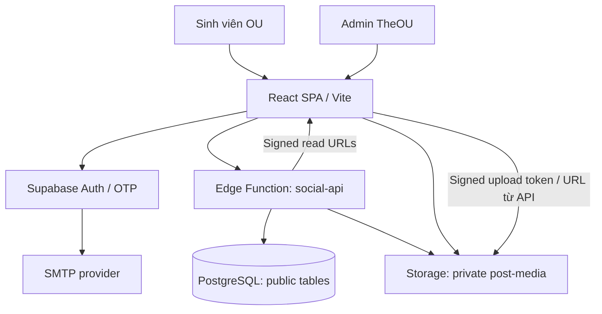
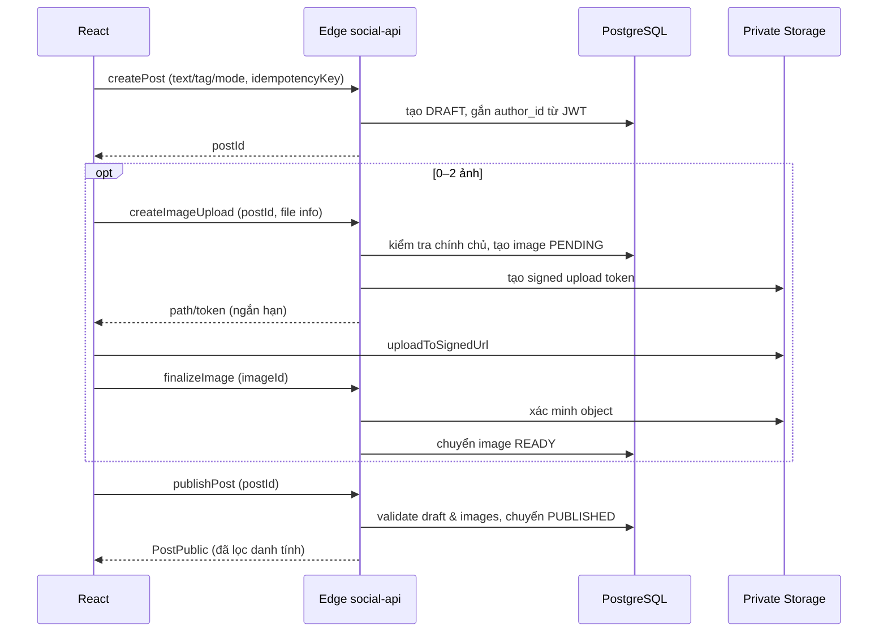

# 04 — Kiến trúc và quyết định kỹ thuật

## 1. Mục tiêu kiến trúc

Đủ nhanh để hoàn thành **Prototype trong 2 tuần**, đồng thời giữ ranh giới giữa UI và nghiệp vụ để sau này có thể thay Edge Functions bằng NestJS mà **không đổi cơ sở dữ liệu hoặc giao diện đồng loạt**.

### Công nghệ

| Lớp | Lựa chọn | Vai trò |
|---|---|---|
| Frontend | React + Vite + TypeScript | SPA mobile-first |
| UI | Tailwind CSS | Design system tối giản |
| Routing | React Router | Auth guard, trang social/admin |
| Server state | TanStack Query | Cache, phân trang, mutation và retry có kiểm soát |
| Auth | Supabase Auth | Email OTP, session JWT |
| Business API | Supabase Edge Functions (TypeScript/Deno) | Xác thực, kiểm tra quyền, nghiệp vụ, dữ liệu an toàn |
| Database | Supabase PostgreSQL | Nội dung, upvote, moderation, audit |
| Media | Supabase Storage **private** | Ảnh bài viết, signed URL ngắn hạn |
| Hosting web | Vercel hoặc static host tương đương | Triển khai SPA HTTPS |
| Email | SMTP bên ngoài tương thích Supabase Auth | Gửi OTP đến email OU |

**Không dùng:** SSR, Next.js, microservices, Kafka/RabbitMQ, Redis, Elasticsearch, realtime websocket trong 4 tuần.

## 2. Sơ đồ hệ thống



**Ranh giới tin cậy:** trình duyệt là môi trường không tin cậy. Supabase publishable key được phép có trong frontend; **service-role/secret key chỉ ở Edge Function**. API phải kiểm tra JWT, email, `profiles.status` và quyền của request. Không dùng client-supplied `userId` cho ownership.

## 3. Tại sao cần Edge Function ngay từ Prototype?

Ẩn danh không thể chỉ là `display_name = Ẩn danh`. Nếu client đọc trực tiếp bảng chứa `author_id` thì có thể ghép các bài của một tài khoản. Vì vậy:

- Mọi đọc/ghi bài viết, bình luận, vote, ảnh và admin qua `social-api`.
- Trả về **DTO công khai**, không chứa email, mã số sinh viên hoặc ID tác giả.
- Không cấp quyền PostgREST trực tiếp lên bảng nghiệp vụ cho role `anon`/`authenticated`; bật RLS và thu hồi grants.
- `social-api` có thể dùng client đặc quyền **chỉ sau khi kiểm tra toàn bộ authorization**; service-role bypass RLS nên mọi truy vấn phải filter và kiểm soát dữ liệu đúng.

Đây là một **backend nhẹ**, không phải lựa chọn “không backend”. Sau này NestJS sẽ thay chính lớp này.

## 4. Tổ chức mã nguồn T01–T02

```text
TheOU/
├── frontend/
│   ├── public/
│   ├── src/
│   │   ├── app/                # App.tsx: Router, provider, query client
│   │   ├── features/
│   │   │   ├── auth/
│   │   │   ├── feed/
│   │   │   ├── posts/
│   │   │   ├── comments/
│   │   │   ├── votes/
│   │   │   ├── profile/
│   │   │   └── moderation/
│   │   ├── shared/
│   │   │   ├── api/            # SocialApiClient + DTO; adapter ở task sau
│   │   │   ├── components/
│   │   │   ├── constants/
│   │   │   └── lib/
│   │   ├── index.css           # Tailwind CSS
│   │   ├── vite-env.d.ts
│   │   └── main.tsx
│   ├── tests/                 # Unit test cấu hình môi trường
│   ├── .env.example           # Mẫu công khai; .env.local bị gitignore
│   ├── index.html
│   ├── package.json
│   ├── package-lock.json
│   ├── vite.config.ts
│   └── tsconfig.json
│
├── supabase/
│   ├── migrations/              # T02: schema, constraints, RLS/grants, triggers
│   ├── functions/               # Giữ chỗ; social-api bắt đầu T04
│   ├── tests/                   # PostgreSQL offline và integration Cloud tách biệt
│   ├── package.json             # Tooling test Node, không phải REST backend
│   ├── package-lock.json
│   ├── tsconfig.json
│   ├── .env.example             # Mẫu env test server, không dùng cho frontend
│   ├── README.md                # Review và quy trình Giai đoạn A/B
│   └── config.toml
│
├── docs/                        # 7 tài liệu tiếng Việt
├── .github/workflows/           # CI frontend và DB offline; không deploy Cloud
│
├── .gitignore
├── AGENTS.md
└── README.md
```

Các thư mục feature, components/constants và `supabase/functions/` chưa dùng được giữ bằng `.gitkeep`, không phải tính năng đã triển khai. Test frontend đặt trong `frontend/tests/`, test DB đặt trong `supabase/tests/`. Từ T04, `supabase/functions/social-api/` gồm `index.ts`, `modules/` theo nghiệp vụ và `shared/` cho auth/errors/validation/client; không dồn toàn bộ logic vào entrypoint.

T01 dùng Tailwind qua plugin Vite, React Router chế độ declarative, TanStack Query provider với retry mặc định tắt. `shared/lib/supabase.ts` cung cấp `getSupabaseClient()` khởi tạo khi cần từ env; dev/build kiểm tra URL và publishable key trước khi đóng gói. Không dùng JWT anon legacy hoặc key đặc quyền trong frontend. `.env.local` được Vite đọc tự động và không commit. Unit test dùng Node.js test runner tích hợp để tránh thêm dependency chỉ phục vụ nền tảng.

## 5. Ranh giới frontend và API

- UI dùng hooks (`useFeed`, `useCreatePost`, `useComments`, `useToggleVote`) gọi `postApi`, `commentApi`, ...
- Adapter hiện tại gọi `supabase.functions.invoke('social-api', { body: { action, payload } })`.
- Các interface TypeScript và response model theo `06-API-CONTRACT.md`, không lộ kiểu dữ liệu Supabase vào UI.
- Supabase Auth SDK chỉ ở module `auth`, **không** gọi bảng nghiệp vụ bằng `.from(...)` ở frontend.
- Optimistic update chỉ dành cho upvote; tạo bài phải dựa vào phản hồi server.

## 6. Luồng xác thực

1. Người dùng nhập email; UI kiểm tra nhanh domain `@ou.edu.vn`.
2. Supabase Auth `signInWithOtp` gửi mã, template email có `{{ .Token }}` để hiện **OTP 6 số**.
3. **Before User Created Hook** chặn tạo tài khoản email ngoài domain, không dựa vào frontend; lưu cấu hình hook và kiểm thử.
4. Người dùng nhập OTP → `verifyOtp({ email, token, type: 'email' })`; Auth trả về session.
5. Mỗi Edge Function user-facing kiểm tra JWT còn hiệu lực, email OU, account ACTIVE và role khi cần; việc đăng ký trước đây không thay thế kiểm tra phiên hiện tại.
6. Không cấp bất kỳ response nội dung riêng tư nào khi chưa qua kiểm tra.

**Cấu hình bắt buộc:** custom SMTP trước khi thử nghiệm nhiều tài khoản; máy chủ email mặc định của Supabase chỉ phục vụ thử nghiệm hạn chế. Các rate limit/auth options có thể thay đổi theo nhà cung cấp và cấu hình dự án.

## 7. Luồng đăng bài có ảnh



Post text không ảnh cũng qua `DRAFT → PUBLISHED`. Retry `createPost` phải có `idempotency_key`, hoặc API tìm draft cũ theo `(author_id, key)`; tránh tạo hai bài khi timeout. Dọn draft và file mồ côi theo kỳ ở MVP; prototype có quy trình thủ công documented.

## 8. Sắp xếp và phân trang

- `Mới nhất`: keyset cursor `(published_at, id)`, 20 bài/trang, giới hạn 50/trang.
- `Nổi bật 24h`: upvote giảm dần, sau đó thời gian và ID; giai đoạn đầu dùng offset cursor đã được validate, giới hạn số trang để tránh truy vấn quá sâu. Khi vote thay đổi có thể trùng/nhảy bài; client dedupe theo `post.id`.
- Cập nhật count (`upvote_count`, `comment_count`) trong **transaction tại database** hoặc RPC atomic; không increment ngây thơ từ nhiều HTTP request.
- Index theo `status, published_at` và tag; đo bằng EXPLAIN trước khi thêm index mới.

## 9. Triển khai và quan sát

- **Môi trường:** frontend chạy tại máy, Development DB dùng Supabase Cloud **TheOU-dev**. Không dùng Docker/Supabase Local Stack. Staging/beta phải có phạm vi tài khoản và phê duyệt riêng. T02 dùng PGlite trong bộ nhớ để kiểm tra migration SQL offline; đây không phải Supabase server và không thay thế test Cloud. Mọi push migration và test ghi Cloud phải được chủ dự án phê duyệt trước.
- **CI tối thiểu:** typecheck, lint, unit test, build, migrations smoke test, Edge tests và e2e chính.
- **Secrets:** frontend chỉ có Supabase URL và publishable key; SMTP, storage admin và database secret chỉ lưu trên Supabase/Vercel server env nếu cần; không commit `.env`.
- **Logging:** log request ID, action, status, thời lượng, error code; **không** log OTP, JWT, email nguyên dạng, nội dung bài nhạy cảm, IP nếu không cần.
- **Giám sát:** lỗi OTP/upload/Edge Function, số request thất bại; kiểm tra ngân sách Storage/email và chi phí egress.
- **Thời gian:** DB UTC, UI theo giờ địa phương VN.

## 10. Chiến lược viết backend riêng sau này

1. Giữ `SocialApiClient` interface và DTO ổn định.
2. Khi cần, tạo NestJS cung cấp API tương đương (không bắt buộc đổi frontend toàn bộ).
3. NestJS xác thực Supabase Auth JWT và kiểm tra account role/status; truy cập PostgreSQL đang sử dụng.
4. Di chuyển từng nhóm nghiệp vụ (feed → post → comment → vote → admin), không chuyển ồ ạt.
5. Kiểm tra quyền truy cập nếu backend dùng database credential đặc quyền: **RLS của người dùng không tự động áp dụng**.
6. Chỉ chuyển auth/storage/database nếu có lý do cụ thể; tránh rewrite không cần thiết.

**Tham khảo chính thức:** https://supabase.com/docs/guides/functions/auth · https://supabase.com/docs/guides/auth/auth-hooks/before-user-created-hook · https://supabase.com/docs/guides/database/postgres/row-level-security
