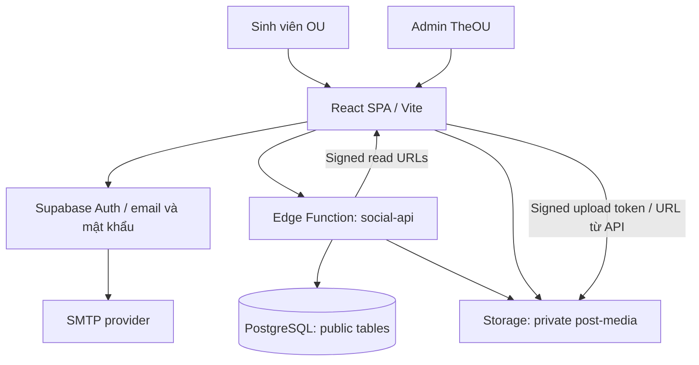
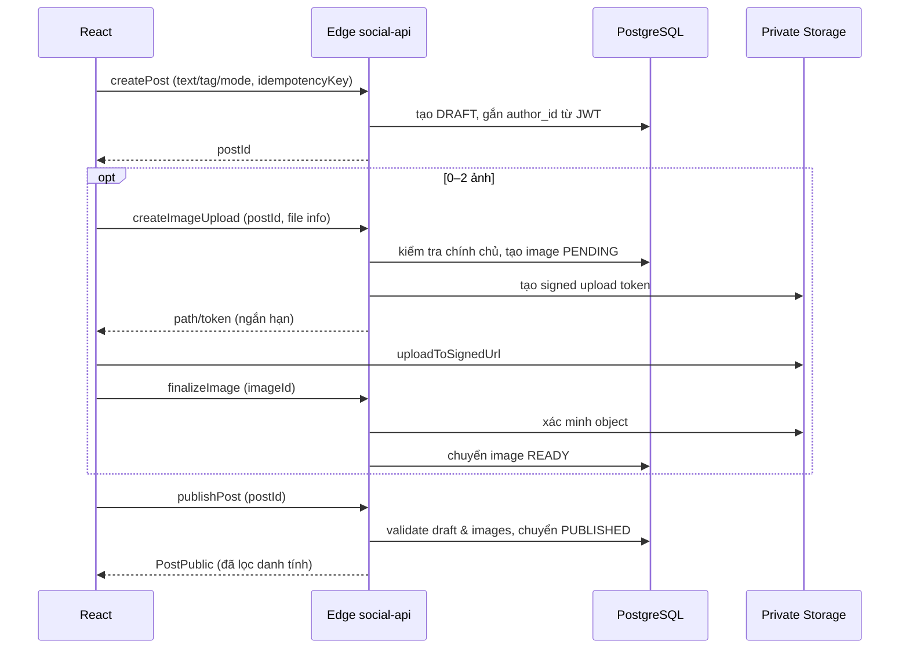

# 04 — Kiến trúc và quyết định kỹ thuật

## 1. Mục tiêu kiến trúc

Đủ nhanh để hoàn thành **Prototype trong 2 tuần**, đồng thời giữ ranh giới giữa UI và nghiệp vụ để sau này có thể thay Edge Functions bằng NestJS mà **không đổi cơ sở dữ liệu hoặc giao diện đồng loạt**.

### Công nghệ

| Lớp | Lựa chọn | Vai trò |
|---|---|---|
| Frontend | React + Vite + TypeScript | SPA mobile-first |
| UI | Tailwind CSS | Design system tối giản |
| Routing | React Router | Auth guard, trang social/admin |
| Server state | TanStack Query | Cache, phân trang, mutation và retry có kiểm soát |
| Auth | Supabase Auth | Email/mật khẩu, OTP xác minh đăng ký, session JWT |
| Business API | Supabase Edge Functions (TypeScript/Deno) | Xác thực, kiểm tra quyền, nghiệp vụ, dữ liệu an toàn |
| Database | Supabase PostgreSQL | Nội dung, upvote, moderation, audit |
| Media | Supabase Storage **private** | Ảnh bài viết, signed URL ngắn hạn |
| Hosting web | Vercel hoặc static host tương đương | Triển khai SPA HTTPS |
| Email | SMTP bên ngoài tương thích Supabase Auth | Gửi OTP đến email OU |

**Không dùng:** SSR, Next.js, microservices, Kafka/RabbitMQ, Redis, Elasticsearch, realtime websocket trong 4 tuần.

## 2. Sơ đồ hệ thống



**Ranh giới tin cậy:** trình duyệt là môi trường không tin cậy. Supabase publishable key được phép có trong frontend; **service-role/secret key chỉ ở Edge Function**. API phải kiểm tra JWT, email, `profiles.status` và quyền của request. Không dùng client-supplied `userId` cho ownership.

## 3. Tại sao cần Edge Function ngay từ Prototype?

Ẩn danh không thể chỉ là `display_name = Ẩn danh`. Nếu client đọc trực tiếp bảng chứa `author_id` thì có thể ghép các bài của một tài khoản. Vì vậy:

- Mọi đọc/ghi bài viết, bình luận, vote, ảnh và admin qua `social-api`.
- Trả về **DTO công khai**, không chứa email, mã số sinh viên hoặc ID tác giả.
- Không cấp quyền PostgREST trực tiếp lên bảng nghiệp vụ cho role `anon`/`authenticated`; bật RLS và thu hồi grants.
- `social-api` có thể dùng client đặc quyền **chỉ sau khi kiểm tra toàn bộ authorization**; service-role bypass RLS nên mọi truy vấn phải filter và kiểm soát dữ liệu đúng.

Đây là một **backend nhẹ**, không phải lựa chọn “không backend”. Sau này NestJS sẽ thay chính lớp này.

## 4. Tổ chức mã nguồn T01–T08-A

```text
TheOU/
├── frontend/
│   ├── public/
│   ├── src/
│   │   ├── app/                # App.tsx: Router, provider, query client
│   │   ├── features/
│   │   │   ├── auth/
│   │   │   ├── feed/
│   │   │   ├── posts/
│   │   │   ├── comments/
│   │   │   ├── votes/
│   │   │   ├── profile/
│   │   │   └── moderation/
│   │   ├── shared/
│   │   │   ├── api/            # SocialApiClient + DTO + adapter invoke/runtime validation
│   │   │   ├── components/
│   │   │   ├── constants/
│   │   │   └── lib/
│   │   ├── index.css           # Tailwind CSS
│   │   ├── vite-env.d.ts
│   │   └── main.tsx
│   ├── tests/                 # Unit test cấu hình môi trường
│   ├── .env.example           # Mẫu công khai; .env.local bị gitignore
│   ├── index.html
│   ├── package.json
│   ├── package-lock.json
│   ├── vite.config.ts
│   └── tsconfig.json
│
├── supabase/
│   ├── migrations/              # T02/T03 và trigger publish T06 đã nghiệm thu
│   ├── functions/social-api/    # index.ts, handler.ts, shared/, modules/profile/, modules/posts/
│   ├── tests/                   # PostgreSQL offline và integration Cloud tách biệt
│   ├── package.json             # Tooling test Node, không phải REST backend
│   ├── package-lock.json
│   ├── tsconfig.json
│   ├── .env.example             # Mẫu env test server, không dùng cho frontend
│   ├── README.md                # Review và quy trình Giai đoạn A/B
│   └── config.toml
│
├── docs/                        # 7 tài liệu tiếng Việt
├── .github/workflows/           # CI frontend và DB offline; không deploy Cloud
│
├── .gitignore
├── AGENTS.md
└── README.md
```

Các thư mục feature chưa dùng được giữ bằng `.gitkeep`, không phải tính năng đã triển khai. Tests frontend ở `frontend/tests/`, DB/Auth/API ở `supabase/tests/`. T04–T07 đã nghiệm thu getMe/updateNickname, Post API và Feed/Composer. T08-A thêm `modules/comments/` và frontend detail/comments local; chưa có vote mutation/media/moderation. `index.ts` khởi động Deno, `handler.ts` dispatch và tái sử dụng shared guard/errors/client/CORS.

**Quyết định T04-A:** gateway giữ `verify_jwt = true`; handler gọi `auth.getUser(token)` bằng publishable client để xác minh với Auth server. Chỉ sau khi email chính xác domain OU và đã xác minh mới khởi tạo client đặc quyền, đọc profile bằng ID từ Auth, chặn BANNED rồi đọc ADMIN từ `user_roles`. Các lượt đọc profile/role này là một phần authorization bắt buộc vì T02 khóa raw tables đối với user client. Client đặc quyền không nhận session/Authorization từ request.

Profile thiếu được insert bằng `upsert(..., { onConflict: 'id', ignoreDuplicates: true })` rồi SELECT lại; không merge/update nickname/status và không cấp role. Khóa chính T02 bảo vệ concurrent initialization; chưa cần migration mới. Nickname mặc định ngẫu nhiên `OUer-1234`, không suy ra từ email/UUID và không yêu cầu duy nhất. Chi tiết kiểm thử, giới hạn và hướng dẫn T04-B ở [báo cáo T04-A](reports/T04-A-IMPLEMENTATION.md).

T01 dùng Tailwind qua plugin Vite, React Router chế độ declarative, TanStack Query provider với retry mặc định tắt. `shared/lib/supabase.ts` cung cấp `getSupabaseClient()` khởi tạo khi cần từ env; dev/build kiểm tra URL và publishable key trước khi đóng gói. Không dùng JWT anon legacy hoặc key đặc quyền trong frontend. `.env.local` được Vite đọc tự động và không commit. Unit test dùng Node.js test runner tích hợp để tránh thêm dependency chỉ phục vụ nền tảng.

## 5. Ranh giới frontend và API

**T05 COMPLETED:** UI theo [baseline](fe-templates/README.md). Feature Auth chứa service, session controller/provider và bốn trang; shared API adapter validate envelope/DTO. SDK tự quản lý session, listener chỉ chuyển state đồng bộ rồi tải getMe ngoài callback; không lưu token riêng. Cache xóa khi đổi user/logout/401/403; protected route chờ Auth và getMe. SessionStorage chỉ giữ email/thời điểm chờ xác minh, localStorage chỉ thêm theme preference. `updateNickname` và bốn action post T06 đã deploy.

**T07 đã nghiệm thu:** AppFrame dùng chung header/theme/disclaimer cho Auth, Feed và Composer; `/` và `/bai-viet/moi` đều qua SessionGate. `useFeed` gọi `useInfiniteQuery`, key `['posts', scope, sort, tag]` với scope là generation phiên, không dùng email/UUID/JWT làm key feed. Cursor opaque từ API, limit=20; đổi filter bỏ cache mục tiêu, refresh reset về trang đầu; dedupe id giữ thứ tự server, không tính lại HOT. Callback chỉ reject Auth nếu còn đúng scope, response muộn bị cô lập/hủy kết quả. Logout/account change hủy và xóa cache.

Adapter của phiên ready giữ Authorization đã chụp trong closure bộ nhớ, tránh SDK lấy nhầm JWT tài khoản khác cho request trễ; timeout 15 giây không đồng nghĩa server rollback. `createPostSubmission` khóa snapshot canonical và UUID trước await; tạo draft ACK mới publish, retry có postId chỉ publish. React dùng external store để phản ánh trạng thái; không component nào gọi SDK trực tiếp. Sau publish, invalidate/bỏ feed cache của scope, về `/` mặc định NEW. Không persist draft/UUID/postId hoặc thêm token vào storage; reload/rời Composer/Auth revalidation có thể mất trạng thái, chưa có recovery qua server. Xem [bàn giao T07-A](reports/T07-A-IMPLEMENTATION.md).

- UI dùng hook `useFeed` và controller `createPostSubmission` gọi `createSocialApi`; comment/vote hooks chưa triển khai.
- Adapter hiện tại gọi `supabase.functions.invoke('social-api', { body: { action, payload } })`.
- Các interface TypeScript và response model theo `06-API-CONTRACT.md`, không lộ kiểu dữ liệu Supabase vào UI.
- Supabase Auth SDK chỉ ở module `auth`, **không** gọi bảng nghiệp vụ bằng `.from(...)` ở frontend.
- Optimistic update chỉ dành cho upvote; tạo bài phải dựa vào phản hồi server.

**T08-A local, chưa deploy:** `modules/comments/` triển khai list/create/delete qua guard/envelope hiện có. `shared/cursor.ts` tách HMAC/base64url để post/comment dùng cùng THEOU_POST_CURSOR_SECRET; post giữ nguyên định dạng v1, comment thêm kind=comments và postId, TTL15phút. Timestamp microseconds giữ nguyên khi làm tuple `(created_at,id)` ASC. Mapper chỉ xuất bảy field CommentPublic, OP so sánh hai author IDs ở server rồi chỉ trả nhãn Chủ bài/boolean; không nickname hoặc commenter identifier xuyên bài.

Migration `20261117024216_t08_atomic_comments.sql` dùng AFTER row trigger cập nhật count bằng delta cùng transaction; parent phải PUBLISHED khi tăng. Không giữ parent lock trước kiểm tra unique conflict của INSERT, không RPC public. Trạng thái DELETED không được phục hồi. Backfill count từ VISIBLE chỉ sửa hàng lệch khi đã khóa writes comments/posts; không reset tùy tiện.

Frontend thêm PostDetailPage và `features/comments/`: query theo scope/postId, client runtime DTO allowlist, snapshot/key retry comment trong bộ nhớ, xóa có điều kiện/confirm và refetch counts từ server. PostCard trên Feed chỉ link phần nội dung tới detail, contact giữ link riêng. Response muộn bỏ theo AbortSignal/scope/mount; parent NOT_FOUND chặn tương tác. Không thay Auth/T07 create→publish hoặc thêm vote/media/admin. Chi tiết và giới hạn Cloud locking ở [bàn giao T08-A](reports/T08-A-IMPLEMENTATION.md).

## 6. Luồng xác thực

**Thay đổi được chủ dự án chốt 15/11/2026:** OTP chỉ xác minh đăng ký; các lần đăng nhập dùng mật khẩu.

1. Đăng ký: module Auth gọi `signUp({ email, password })` với email thuộc chính xác `@ou.edu.vn`; mật khẩu không trim, tối thiểu 8 ký tự và tối đa 72 byte UTF-8. Supabase Auth lưu hash, không đưa mật khẩu qua social-api hoặc app DB.
2. **Before User Created Hook** giữ nguyên, chặn tạo tài khoản email ngoài domain phía server. Confirm email phải bật: signup trả session null.
3. Template **Confirm signup** dùng `{{ .Token }}` để gửi OTP 6 số; `verifyOtp({ email, token, type: 'email' })` xác minh đăng ký và trả session. UI T05 gửi lại bằng `resend({ type: 'signup', email })` theo cooldown.
4. Đăng nhập: `signInWithPassword({ email, password })`, không gọi `signInWithOtp`, không yêu cầu OTP. Email chưa xác minh hoặc mật khẩu sai không có session.
5. Mỗi Edge Function user-facing kiểm tra JWT còn hiệu lực, email OU **đã xác minh**, account ACTIVE và role khi cần; việc đăng ký trước đây không thay thế kiểm tra phiên hiện tại.
6. Đăng xuất dọn session; không lưu mật khẩu/OTP/JWT trong log. Chưa triển khai quên/đổi mật khẩu hoặc tự chuyển đổi tài khoản OTP cũ trong T03.

**Cấu hình bắt buộc:** custom SMTP trước khi thử nghiệm nhiều tài khoản; máy chủ email mặc định của Supabase chỉ phục vụ thử nghiệm hạn chế. Các rate limit/auth options có thể thay đổi theo nhà cung cấp và cấu hình dự án.

**T03 COMPLETED (16/11/2026):** hook domain đã triển khai, passwordless bị tắt phía server; password login regression PASS theo chủ dự án. Signup/OTP đã PASS trước thay đổi settings; regression sau thay đổi chuyển T05 khi có OU account mới. Hook không kiểm soát Admin API hoặc đăng nhập account đã tồn tại, nên guard T04 vẫn kiểm tra email/confirmed/status từng request. Xem [nghiệm thu T03](reports/T03-STATUS-REPORT.md).

**T05 đã hoàn tất regression:** chủ dự án xác nhận signup OU alias +t05, SMTP/OTP xác minh và password login sau tắt passwordless PASS. Alias policy theo AUTH-ALIAS-001, không xử lý trong T06.

## 7. Luồng đăng bài có ảnh



Post text không ảnh cũng qua `DRAFT → PUBLISHED`. Retry `createPost` phải có `idempotency_key`, hoặc API tìm draft cũ theo `(author_id, key)`; tránh tạo hai bài khi timeout. Dọn draft và file mồ côi theo kỳ ở MVP; prototype có quy trình thủ công documented.

**T06 chỉ text, đã nghiệm thu Cloud:** INSERT ON CONFLICT DO NOTHING rồi đối chiếu payload; publish dùng UPDATE có điều kiện owner/DRAFT và trigger riêng khóa profile, lấy snapshot, đặt timestamp trong cùng statement. Không RPC public. Media trong sơ đồ là thiết kế T10: hiện publish từ chối image row và mapper chỉ xuất images=[] khi không có ảnh. T07-A không sửa backend/migration hoặc deploy.

## 8. Sắp xếp và phân trang

- T06-A dùng keyset cho cả NEW `(published_at,id)` và HOT `(upvote_count,published_at,id)`, giảm dần, tối đa 20 bài/trang. Quyết định này thay mô tả cũ offset HOT/giới hạn 50 theo yêu cầu T06 mới.
- Cursor ký HMAC, gắn sort/tag và mốc trên của lần đọc đầu, hạn 15 phút; không chứa author ID. HOT lọc 24 giờ so với thời điểm mỗi request. Vote/status thay đổi vẫn có thể gây lặp/bỏ sót: T07 cần dedupe theo post.id và refresh, không có snapshot consistency.
- Cập nhật count (`upvote_count`, `comment_count`) trong **transaction tại database** hoặc RPC atomic; không increment ngây thơ từ nhiều HTTP request.
- Index theo `status, published_at` và tag; đo bằng EXPLAIN trước khi thêm index mới.

## 9. Triển khai và quan sát

- **Môi trường:** frontend chạy tại máy, Development DB dùng Supabase Cloud **TheOU-dev**. Không dùng Docker/Supabase Local Stack. Staging/beta phải có phạm vi tài khoản và phê duyệt riêng. T02 dùng PGlite trong bộ nhớ để kiểm tra migration SQL offline; đây không phải Supabase server và không thay thế test Cloud. Mọi push migration và test ghi Cloud phải được chủ dự án phê duyệt trước.
- **CI tối thiểu:** typecheck, lint, unit test, build, migrations smoke test, Edge tests và e2e chính.
- **Secrets:** frontend chỉ có Supabase URL và publishable key; SMTP, storage admin và database secret chỉ lưu trên Supabase/Vercel server env nếu cần; không commit `.env`.
- **Logging:** log request ID, action, status, thời lượng, error code; **không** log mật khẩu, OTP, JWT, email nguyên dạng, nội dung bài nhạy cảm, IP nếu không cần.
- **Giám sát:** lỗi OTP/upload/Edge Function, số request thất bại; kiểm tra ngân sách Storage/email và chi phí egress.
- **Thời gian:** DB UTC, UI theo giờ địa phương VN.

## 10. Chiến lược viết backend riêng sau này

1. Giữ `SocialApiClient` interface và DTO ổn định.
2. Khi cần, tạo NestJS cung cấp API tương đương (không bắt buộc đổi frontend toàn bộ).
3. NestJS xác thực Supabase Auth JWT và kiểm tra account role/status; truy cập PostgreSQL đang sử dụng.
4. Di chuyển từng nhóm nghiệp vụ (feed → post → comment → vote → admin), không chuyển ồ ạt.
5. Kiểm tra quyền truy cập nếu backend dùng database credential đặc quyền: **RLS của người dùng không tự động áp dụng**.
6. Chỉ chuyển auth/storage/database nếu có lý do cụ thể; tránh rewrite không cần thiết.

**Tham khảo chính thức:** https://supabase.com/docs/guides/functions/auth · https://supabase.com/docs/guides/auth/auth-hooks/before-user-created-hook · https://supabase.com/docs/guides/database/postgres/row-level-security
