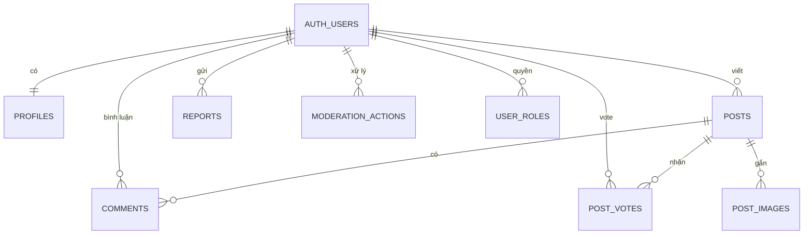

# 05 — Thiết kế Database, danh tính ẩn danh và bảo mật

Đây là **đặc tả thiết kế**; phần schema T02 đã có migration và test quyền được phép/bị từ chối, đã triển khai lên Cloud. RLS và grants là cổng an toàn; các Edge Functions dùng secret/admin vẫn phải tự kiểm tra quyền vì có thể bypass RLS.

**T02 — COMPLETED (15/11/2026):** migration `supabase/migrations/20261113170214_t02_schema_security.sql` đã áp dụng trên TheOU-dev; catalog đạt, offline 22/22 PASS, Cloud 8/8 PASS theo xác nhận chủ dự án và cleanup đã xác minh read-only. Timestamp tên file do CLI sinh theo UTC. Xem [báo cáo nghiệm thu](reports/T02-STATUS-REPORT.md); các phần nghiệp vụ/API bên dưới vẫn thuộc task tiếp theo.

**T03 — COMPLETED 16/11/2026:** giữ nguyên `20261115050213_t03_before_user_created_hook.sql` đã triển khai Cloud. Function `theou_private.before_user_created(jsonb)` chỉ cho domain chính xác ou.edu.vn, SECURITY INVOKER/search_path rỗng; supabase_auth_admin có EXECUTE/USAGE, không thêm quyền bảng. Đăng ký email + mật khẩu rồi OTP xác minh; đăng nhập mật khẩu, passwordless bị chặn ở server. Mật khẩu chỉ được Auth lưu hash, không lưu trong profiles/bảng nghiệp vụ. Confirm email bật; T04 kiểm tra email đã xác minh/OU/ACTIVE trên mỗi request. Hook không chặn Admin API/account ngoài OU đã có sẵn, không có Gmail exception. Chưa làm quên/đổi mật khẩu. Signup/OTP regression sau đổi settings chuyển T05; xem [nghiệm thu T03](reports/T03-STATUS-REPORT.md).

**T04 — COMPLETED 16/11/2026, getMe đã deploy:** guard xác minh bằng Auth server, chỉ dùng ID/email đã xác minh từ Auth. Client đặc quyền đọc `profiles` và `user_roles` để kiểm tra ACTIVE/ADMIN; mỗi truy vấn filter theo ID chính chủ, không lấy quyền từ metadata/payload. Khởi tạo profile dùng INSERT ON CONFLICT DO NOTHING rồi đọc lại, không UPDATE trạng thái/nickname hoặc role. Không sửa migration/grants/RLS T02; không có migration mới. `getMe` chỉ trả nickname, email che toàn bộ local part (`***@ou.edu.vn`) và boolean isAdmin. Các request đang xử lý không được khóa cùng thao tác ban; request sau phải đọc trạng thái mới, không cache authorization.

**T05-A local:** updateNickname tái sử dụng guard, chỉ PATCH nickname, filter ID do Auth xác minh và status ACTIVE trong chính UPDATE. Không sửa migration/grants/RLS; chưa deploy action hoặc kiểm thử Cloud.

### Quyết định triển khai T02

- Dùng UUID, `timestamptz`, `text + CHECK` cho trạng thái/tag; 9 bảng đúng đặc tả, kể cả cấu trúc `reports` để chuẩn bị W3. Chưa có API report, bucket Storage, trigger tạo profile Auth hoặc logic kiểm duyệt/rate limit.
- FK tới `auth.users` và bài viết dùng `ON DELETE RESTRICT`: không tự cascade mất nội dung/audit khi xóa tài khoản. Luồng sản phẩm xóa mềm; quy trình xóa tài khoản thuộc T17. Chưa tự cấp admin hoặc lấy role từ metadata.
- Tất cả bảng bật ENABLE/FORCE RLS, có restrictive policy `deny_direct_client` với `USING false/WITH CHECK false` cho `anon` và `authenticated`. Thu hồi mọi table privilege của hai role và `PUBLIC`; kể cả tác giả bài hoặc admin đăng nhập cũng không đọc/ghi bảng trực tiếp.
- `service_role` chỉ có SELECT/INSERT/UPDATE/DELETE trên bảng cần CRUD; `moderation_actions` chỉ SELECT/INSERT, không UPDATE/DELETE/TRUNCATE. Role này bypass RLS: quyền domain/account/owner/admin vẫn là trách nhiệm `social-api` T04 trở đi, không được tuyên bố DB đã xác thực người gọi thay API.
- Helper trigger nằm ở `theou_private`, SECURITY INVOKER, `search_path = ''`, không mở quyền cho client. Trigger chặn đổi ID/chủ sở hữu/idempotency key và quan hệ bài của comment/vote/ảnh; tự cập nhật `updated_at` cho profile/post/comment.
- Không có public view/RPC/read model mở cho client ở T02. Server sẽ xuất DTO allowlist ở T06/T08: OP được suy ra bằng so sánh author của comment với post trong server, không gửi các UUID này về UI.
- `ANONYMOUS` bắt buộc `nickname_snapshot` và `contact_url` NULL; `NICKNAME` cần snapshot 3–30 ký tự. Contact chỉ cho `TAI_LIEU`/`TIM_TRO`, HTTPS và các host `zalo.me`, `facebook.com`, `www.facebook.com`, `m.facebook.com`, `m.me`. Đây là allowlist cụ thể cho yêu cầu Zalo/Facebook/Messenger; thay đổi host cần migration/test, server vẫn phải parse URL.
- Ảnh dùng path `posts/{post_id}/{image_id}.{jpg|png|webp}` tương ứng MIME, không chứa user ID; unique vị trí 1/2 giới hạn hai ảnh trên mỗi bài. Schema không xác thực nội dung file, EXIF hoặc signed URL; phần đó thuộc T10.
- `reports.target_id` và `moderation_actions.target_id` đa hình không có FK, phải kiểm chứng tồn tại/phạm vi trong server. Counts hiện là cột không âm; RPC/transaction cập nhật count, publish/idempotency response và rate limit atomic phải bổ sung cùng nghiệp vụ T06/T08/T09/T16, chưa có bảo đảm atomic cho luồng ứng dụng ở T02.
- Thu hồi default privileges cho object mới do `postgres` tạo trong `public`, và EXECUTE mặc định của PUBLIC cho function mới do `postgres` tạo ở mọi schema (Postgres không cho thu hồi global default bằng IN SCHEMA). Không sửa quyền object hiện có ngoài 9 bảng và helper của migration. Migration sau phải review/grant tường minh; role tạo object khác cần kiểm tra riêng.

**Phân biệt tiêu chí:** “A được xóa bài mình, B bị từ chối” là test API tương lai (T06/T11). T02 kiểm tra A/B đều bị từ chối trên raw tables; server CRUD được phép không phải bằng chứng ownership authorization của API. Không mở client policies để vượt qua test sai tầng. Phần SQL metadata/constraints được kiểm tra offline; JWT thật/PostgREST chỉ được kết luận sau Giai đoạn B.

## 1. ERD tối giản

`auth.users` do Supabase quản lý, **không sửa bảng này để thêm cột nghiệp vụ**. FK ứng dụng đến `auth.users(id)` phải có chính sách xóa phù hợp; ưu tiên soft-delete nội dung.

## 2. Bảng và dữ liệu

### `profiles`

| Cột | Loại | Ràng buộc |
|---|---|---|
| `id` | uuid | PK, FK `auth.users.id` |
| `nickname` | varchar(30) | NOT NULL, 3–30 ký tự, không dùng email mặc định |
| `status` | text/enum | `ACTIVE`, `BANNED` |
| `created_at`, `updated_at` | timestamptz | UTC, NOT NULL |

Dữ liệu nhạy cảm email vẫn ở `auth.users`, không nhân bản nếu không có nhu cầu. Chỉ `getMe` được trả email cho **chính chủ**, feed không bao giờ trả profile ID của tác giả khác.

### `user_roles`

`(user_id uuid FK, role enum('ADMIN'), created_at timestamptz, granted_by uuid nullable)`. PK `(user_id,role)`. Người dùng thường mặc định không có record admin. **Không** nhận role từ `user_metadata` hoặc payload client.

### `posts`

| Cột | Loại | Quy tắc |
|---|---|---|
| `id` | uuid | PK, UUID ngẫu nhiên |
| `author_id` | uuid | FK `auth.users.id`, **bí mật** |
| `tag` | enum/text check | `CONFESSION`, `REVIEW_MON`, `TAI_LIEU`, `TIM_TRO`, `HOI_GAP` |
| `body` | varchar(1000) | trim, 1–1.000 ký tự |
| `display_mode` | enum | `ANONYMOUS`, `NICKNAME` |
| `nickname_snapshot` | varchar(30) nullable | Chỉ có khi `NICKNAME` |
| `contact_url` | text nullable | Chỉ áp dụng 2 tag và `NICKNAME`, hostname allowlist |
| `status` | enum | `DRAFT`, `PUBLISHED`, `HIDDEN`, `DELETED` |
| `idempotency_key` | uuid | Khóa tạo bài duy nhất theo người dùng |
| `upvote_count` | int | ≥0, cache từ bảng vote |
| `comment_count` | int | ≥0, cache từ bình luận đang hiển thị |
| `created_at`, `published_at`, `updated_at` | timestamptz | `published_at` khi publish |

**Constraints:** `UNIQUE(author_id,idempotency_key)`; `contact_url IS NULL` nếu ẩn danh hoặc không thuộc tag cho phép; status enum; `CHECK(upvote_count >=0, comment_count>=0)`.

### `comments`

`id uuid PK`, `post_id uuid FK`, `author_id uuid FK` **bí mật**, `idempotency_key uuid NOT NULL`, `body varchar(500)`, `status ('VISIBLE','HIDDEN','DELETED')`, `created_at`, `updated_at`. Ràng buộc `UNIQUE(author_id,idempotency_key)` cho request retry. Không hỗ trợ nested reply nên không có `parent_id`. API chỉ trả `is_owner` đối với người hiện tại và `is_original_poster` đúng khi commenter là author của **post đó**; không gửi `author_id`.

### `post_votes`

`post_id uuid FK`, `user_id uuid FK`, `created_at timestamptz`, PK `(post_id,user_id)`. Không có downvote. Đổi trạng thái vote phải atomic/idempotent theo request; tránh race giữa hai lần bấm.

### `post_images`

`id uuid PK`, `post_id uuid FK`, `storage_path text` **nội bộ**, `mime_type text`, `size_bytes int`, `position smallint (1..2)`, `status ('PENDING','READY')`, `created_at`. `UNIQUE(post_id,position)`; chỉ ảnh `READY` được xuất qua API; `post_images` không có email/MSSV trong tên file. `storage_path`: `posts/{post_uuid}/{image_uuid}.webp` hoặc định dạng cho phép.

### `reports` — MVP W3

`id uuid PK`, `reporter_id uuid FK` **bí mật**, `target_type ('POST','COMMENT')`, `target_id uuid`, `reason ('SPAM','HARASSMENT','PRIVACY','MISINFORMATION','COPYRIGHT','OTHER')`, `detail varchar(300) nullable`, `status ('PENDING','RESOLVED','DISMISSED')`, `created_at`, `resolved_at nullable`, `resolved_by uuid nullable`.

- `UNIQUE(reporter_id,target_type,target_id)` để chặn trùng.
- Target polymorphic phải được kiểm chứng tồn tại và phù hợp trong **Edge Function**; không tin `target_id` do client gửi.
- Reporter identity chỉ admin xử lý nội bộ theo nguyên tắc cần biết, không trả cho tác giả bài.

### `moderation_actions`

`id uuid PK`, `admin_id uuid FK`, `target_type`, `target_id`, `action ('HIDE','RESTORE','BAN_USER','UNBAN_USER','REPORT_RESOLVE','REPORT_DISMISS')`, `reason text`, `created_at`. Chỉ insert qua luồng server đã authorize; không expose write cho client.

### `rate_limit_counters` — mức cơ bản trước W2, nâng cấp W3

`actor_id uuid`, `action varchar(40)`, `window_start timestamptz`, `count int`, PK `(actor_id,action,window_start)`. Dùng upsert atomic trong transaction/RPC; không dựa vào state của một Edge instance. Có job xóa cửa sổ cũ. Ngưỡng đề xuất để bắt đầu thử nghiệm (cấu hình được, không coi là chuẩn vĩnh viễn): 5 bài/15 phút; 30 bình luận/15 phút; 90 lượt tương tác vote/15 phút; 5 report/ngày. Prototype bắt buộc giới hạn tạo bài/bình luận cơ bản; W3 hoàn thiện giới hạn theo mọi action. Không dựa vào `X-Forwarded-For` chưa được xác thực để nhận dạng người dùng.

## 3. Index đề xuất

- `posts(status, published_at DESC, id DESC)`.
- `posts(status, tag, published_at DESC, id DESC)`.
- `posts(status, published_at DESC, upvote_count DESC)` cần xem EXPLAIN vì `hot` lọc 24 giờ và sort theo vote.
- `comments(post_id, created_at ASC, id ASC)`.
- `post_votes(post_id,user_id)` do PK; `post_images(post_id,position)` unique; `reports(status,created_at DESC)`.

Không tạo index tràn lan trước khi đo query thực tế.

## 4. Chế độ ẩn danh — threat model

**Mục tiêu:** Người đọc thông thường không truy ra danh tính tài khoản thật của một bài `ANONYMOUS` bằng UI, REST API, Supabase Data API hoặc Storage.

### Không được tiết lộ qua

1. DTO: tuyệt đối không có `author_id`, `auth.uid`, email, MSSV, Google identity, `user_metadata`, `reporter_id`.
2. Quan hệ: không trả profile ID hoặc author token ổn định để nối bài ẩn danh với nhau.
3. Comment: khi chủ bài bình luận, chỉ có nhãn `Chủ bài`; không có nickname/ID tài khoản trong response.
4. Media: đường dẫn object không chứa email, MSSV hoặc UUID của tác giả. Ảnh được loại EXIF/GPS khi xử lý trước upload; cần kiểm tra thực tế.
5. Log: không log mật khẩu, JWT, OTP, nội dung nhạy cảm; che email và IP khi không cần lưu.
6. Client: không nhận row database nguyên gốc rồi xóa trường bằng JavaScript; server chỉ chọn trường được phép trả.

**Giới hạn phải công bố:** tính ẩn danh áp dụng trước cộng đồng, không phải trước quản trị viên có thẩm quyền hay nhà cung cấp hạ tầng; người viết vẫn có thể tự tiết lộ danh tính qua nội dung/hình ảnh; signed URL có thể được chia sẻ trong thời hạn hiệu lực.

## 5. Chính sách DB/Storage

### Bảng nghiệp vụ

- Bật RLS **trên mọi bảng nghiệp vụ** ở schema exposed.
- **Thu hồi grants SELECT/INSERT/UPDATE/DELETE** của role `anon` và `authenticated` đối với các bảng `profiles`, `posts`, `comments`, `post_votes`, `post_images`, `reports`, `moderation_actions`, `user_roles`, `rate_limit_counters`. Không chỉ viết policy mà quên grants.
- Frontend chỉ dùng Auth SDK, Edge Function và signed upload; không dùng `.from('posts')`.
- Với `social-api`, chỉ sử dụng client quyền đặc biệt ở server; check user + domain + profile status + role + owner trước **mọi** hành động. Không tin `userId`, `role`, `authorId` truyền từ frontend.
- Không tạo view `security definer` public mặc định mà chưa đánh giá nguy cơ bypass RLS.
- Tài khoản admin được cấp qua seed/migration/bảng vai trò bởi người vận hành, không phải tự đăng ký từ UI.

### Storage

- Bucket `post-media` đặt **private**, chỉ JPG/PNG/WebP và giới hạn kích thước. Ảnh đọc dùng signed URL TTL mặc định 5 phút; token tải lên có thể còn hiệu lực tối đa theo quy định của Supabase (hiện 2 giờ), vì vậy phải kiểm tra quyền cả ở khâu cấp token và khi hoàn tất/publish.
- Signed upload token được tạo **sau khi API xác minh quyền sở hữu DRAFT**; path server tạo bằng UUID ngẫu nhiên không chứa định danh.
- `finalizeImage` xác minh metadata object và khớp bản ghi PENDING, chống reuse/chiếm upload token; publish chỉ khi tất cả ảnh READY.
- Đọc ảnh: Edge Function xác minh user được phép xem bài, trả signed URL ngắn hạn. Hết hạn cần xin lại.
- **Không có khả năng thu hồi ngay lập tức một signed URL đã cấp** chỉ bằng khóa bài; cần URL ngắn hạn, xử lý xóa/move object theo chính sách, cân nhắc cache.

## 6. Authorization matrix

| Tác vụ | Khách | Thành viên ACTIVE | Chủ nội dung | Admin |
|---|---:|---:|---:|---:|
| Đọc feed | ❌ | ✅ | ✅ | ✅ |
| Tạo bài/comment/vote | ❌ | ✅ | ✅ | ✅ |
| Xóa bài/comment của A | ❌ | ❌ | ✅ (A) | ✅ (ẩn/gỡ) |
| Xem identity của tác giả ẩn danh | ❌ | ❌ | Chính bản thân với dữ liệu `/me` | Có điều kiện, log audit |
| Đọc reports | ❌ | ❌ | ❌ | ✅ |
| Ẩn, khôi phục bài, ban user | ❌ | ❌ | ❌ | ✅ |
| Xem ảnh bài hiện hành | ❌ | ✅ qua URL tạm | ✅ | ✅ |

**Lưu ý:** Các ô admin không có nghĩa API mặc định trả identity của tất cả mọi người. Chỉ cung cấp đủ để xử lý vi phạm và ghi audit.

## 7. Kiểm thử DB/authorization (không thể bỏ)

- `anon` gọi Data API `public.posts` → bị từ chối.
- `authenticated` gọi trực tiếp Data API `public.posts`/`public.profiles` → bị từ chối, dù đã xác minh email và đăng nhập bằng mật khẩu.
- JWT email không hợp lệ, user banned → `social-api` trả 403.
- B sở hữu JWT hợp lệ nhưng gửi `postId` của A trong thao tác xóa → 403.
- B xem bài ẩn danh của A → không có identity trong JSON, ảnh URL, logs trả về.
- A upvote 2 request đồng thời → chỉ có một vote và count nhất quán.
- Admin bị giả mạo bằng client payload → 403; admin thật thực hiện hide → audit được ghi.
- Người không đăng nhập không lấy được signed read URL của ảnh; bucket private không truy cập public.
- Người dùng không được upload ảnh cho bài người khác và không được vượt 2 ảnh.

## 8. Dữ liệu, retention và quyền riêng tư

- Soft-delete bài và bình luận để xử lý khiếu nại có kiểm soát; không hiển thị nội dung đã xóa trong UI.
- Xây quy trình yêu cầu xóa tài khoản/dữ liệu, lịch sử xử lý và thời hạn lưu trữ trước beta công khai; không cam kết "xóa vĩnh viễn" khi chưa triển khai.
- Cần phương thức liên hệ nội dung vi phạm, và quy trình xử lý thông tin cá nhân bị công khai trái phép.
- Với tài liệu nhạy cảm liên quan nhà trường, ưu tiên chỉ cho phép liên kết hoặc trao đổi sách vật lý hợp pháp, không host file lậu.

**Nguồn kỹ thuật:** https://supabase.com/docs/guides/database/postgres/row-level-security · https://supabase.com/docs/guides/functions/auth · https://supabase.com/docs/guides/storage/buckets/fundamentals · https://supabase.com/docs/guides/storage/security/signing-keys
